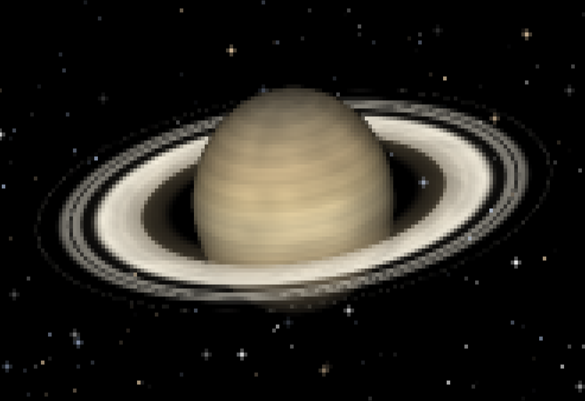

# saturn

A living Saturn in your terminal: ray-cast banded globe with drifting storms,
translucent ring system with Cassini and Encke gaps, reciprocal shadows,
Keplerian ring shear, twinkling color-temperature stars, occasional meteors.
Truecolor half-block pixels at 24 fps, one `write()` per frame. Runs forever in
the background of a work terminal.

## Snapshot


## run

```sh
cargo run --release             # live
cargo run --release -- --ascii  # luminance-glyph mode
cargo run --release -- --fps 12
```

Keys: `q` / `esc` / `ctrl-c` quit · `h` hide the status line · `a` toggle ascii.

Needs a truecolor terminal for the full look (kitty, alacritty, foot, wezterm,
iTerm2, Windows Terminal). Degrades to 256 then 16 colors automatically; force
with `SATURN_COLOR=256`.

## what moves

- **Globe** spins once per 26 s, differential (equator leads): value-noise cloud
  streaks shear, and three pale storm ovals drift with the flow.
- **Rings** shimmer with Keplerian shear (`ω ∝ r^-1.5`); ringlet ridges are
  radial-only, as in reality.
- **Shadows are reciprocal**: ring plane darkens the winter hemisphere (softly,
  45% — full strength reads as dirt), globe casts a shadow notch across the
  rings; a ±7° azimuth drift (240 s) makes the notch travel.
- **Camera** breathes: tilt 20±6° / 160 s, roll ±2.5° / 140 s.
- **Sky**: stars twinkle on independent phases with blue/white/amber tints and
  are occulted by globe and opaque rings; a meteor streaks by every ~15–35 s.

## how it renders

Orthographic ray-cast per half-block pixel (`▀` = fg top, bg bottom), 2×2
supersampled. ASCII mode downsamples the same pixel pair into one glyph, so both
modes share geometry and lighting. Cell aspect ratio is measured from the
terminal's pixel size when reported (`--aspect` to override), so round planets
on any font.

Output contract: autowrap off, rows addressed with `ESC[r;1H`, each row closed by
an explicit black-bg `ESC[K` (erase paints with the current bg SGR — erasing with
a star's color leaves stripes), status line padded with real spaces, no
newlines in a frame, colors delta-encoded, single `write()` per frame.
Resize-safe; panic hook restores the tty on every exit path.

## frame gate (headless capture)

```sh
mkdir -p frames
cargo run --release -- --snapshot frames/saturn
cat frames/saturn-140x45-t045.ans
# squint test: open frames/saturn-140x45-t045.lum.txt in an editor
```

## license

MIT
